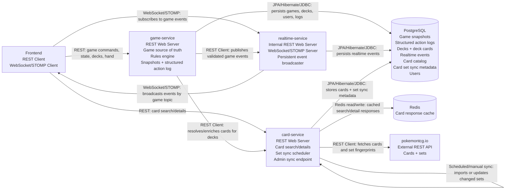
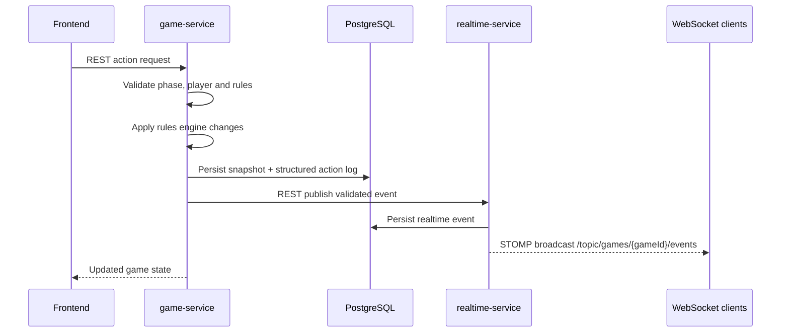

# Pokemon TCG Platform

Plataforma full stack para una version digital de Pokemon TCG, desarrollada como Trabajo Practico Integrador de Programacion III. El objetivo es soportar partidas de 2 jugadores con backend como fuente de verdad, mazos de 60 cartas, cartas reales del set `xy1`, persistencia de estado y eventos en tiempo real.

El backend esta dividido en tres microservicios (`game-service`, `card-service` y `realtime-service`) y el frontend es una aplicacion Angular (`pokemon-tcg-frontend`). La carpeta `src/` de la raiz corresponde a una etapa legacy y no forma parte de la implementacion actual.

## Stack

| Capa | Tecnologia |
| --- | --- |
| Backend | Java 21, Spring Boot 3.5.x, Maven multi-modulo |
| Frontend | Angular 21, TypeScript, RxJS, STOMP.js |
| REST | Spring Web |
| Persistencia | PostgreSQL, Spring Data JPA, Hibernate, Flyway |
| Tiempo real | Spring WebSocket / STOMP |
| Cache | Redis |
| API externa | pokemontcg.io v2 |
| Seguridad | Spring Security, JWT en `game-service` |
| Documentacion | Swagger / OpenAPI 3 |
| Testing | JUnit 5, Mockito, Spring Boot Test, JaCoCo en `game-service`, Playwright (E2E) |

## Servicios

| Servicio | Puerto | Responsabilidad |
| --- | ---: | --- |
| `game-service` | 8081 | Partidas, reglas, mazos, snapshots, action log, JWT |
| `realtime-service` | 8082 | Recepcion de eventos validados, persistencia y broadcast WebSocket/STOMP |
| `card-service` | 8083 | Busqueda de cartas, catalogo local, sync contra pokemontcg.io, Redis cache |
| PostgreSQL | 5433 | Base compartida para mazos, partidas, eventos y cartas |
| Redis | 6380 | Cache de respuestas de cartas |

Dentro de Docker, PostgreSQL escucha en `postgres:5432` y Redis en `redis:6379`.

## Arquitectura De Comunicacion



## Flujo De Una Accion De Juego



## Estructura Del Repo

```text
tpi-pokemon-2w1-14/
├── card-service/       # Catalogo de cartas, cache, sync con pokemontcg.io
├── game-service/       # Motor de juego, reglas, mazos, JWT, persistencia
├── realtime-service/   # REST interno + WebSocket/STOMP broadcaster
├── pokemon-tcg-frontend/ # Cliente Angular: mazos, tablero de partida, tests E2E
├── docs/               # Documentacion tecnica y pruebas manuales
├── docker-compose.yml
├── pom.xml             # Parent Maven
└── src/                # Legacy, no usar para el desarrollo actual
```

## Capas Principales

`game-service` sigue una separacion por capas:

```text
presentation/controller
        -> application/service
        -> domain/facade
        -> domain/engine + chain + strategy + model
        -> infrastructure/persistence / client / repository
```

`card-service` concentra integracion externa, cache y persistencia de catalogo:

```text
presentation
        -> application
        -> infrastructure
        -> infrastructure/persistence
```

`realtime-service` no modifica partidas: recibe eventos ya validados desde `game-service`, los persiste y los emite por WebSocket.

## Patrones Aplicados

| Patron | Uso |
| --- | --- |
| Facade | `GameEngineFacade` simplifica el acceso al motor |
| Repository | Repositorios JPA e implementaciones de estado |
| State | Estados de partida y fases de turno |
| Chain of Responsibility | Pipeline de resolucion de ataque |
| Strategy | Efectos de ataques, entrenadores y habilidades |
| Observer / Publisher | Publicacion de eventos de juego hacia realtime |
| Cache-Aside | `card-service` lee de PostgreSQL/Redis y consulta API externa si hace falta |

## Estado Funcional

Implementado:

- Creacion de usuarios y login con JWT en `game-service`.
- CRUD de mazos por jugador.
- Enriquecimiento de cartas de mazo usando `card-service`.
- Validacion de mazos: 60 cartas, maximo 4 copias salvo energia basica, al menos 1 Pokemon Basico y regla Ace Spec.
- Catalogo local de cartas en PostgreSQL.
- Sync manual/programado de sets en `card-service` contra pokemontcg.io.
- Creacion de partidas con `deckId` para ambos jugadores.
- Setup automatico e interactivo.
- Mulligan, mano inicial, activo, banca y premios.
- Fases `DRAW`, `MAIN`, `ATTACK`, `BETWEEN_TURNS`.
- Acciones principales: draw, attach energy real desde mano, bench Pokemon, evolve, play trainer, use ability, retreat, attack, take prize, status, resolve between turns, end turn.
- Energia real por carta adjunta a Pokemon activo o banca.
- Ataque con validacion de energia, debilidad, resistencia, dano, KO, premios y victoria.
- Condiciones especiales: `ASLEEP`, `PARALYZED`, `CONFUSED`, `POISONED`, `BURNED`.
- Muerte subita.
- Snapshots completos y action log estructurado.
- Eventos realtime persistidos y broadcast por STOMP.
- Endpoint de mano propia por jugador.
- Swagger UI en los servicios.
- Tests unitarios e integracion para los flujos principales.

Alcance:

- El repositorio contiene los microservicios backend y el frontend Angular del TPI.
- Los efectos de cartas se resuelven mediante estrategias registradas; si una carta o habilidad no tiene estrategia disponible, el backend rechaza la accion con un error claro.
- La identidad del jugador se valida con JWT en REST y WebSocket/STOMP.
- La cobertura JaCoCo de `game-service` cumple el umbral configurado: 80%+ global y 90%+ en componentes criticos del motor.

## Reglas De Juego Cubiertas

### Setup

- Cada jugador usa un mazo de 60 cartas.
- Se roban 7 cartas iniciales.
- Si no hay Pokemon Basico, se ejecuta mulligan.
- Se elige Pokemon Activo y Banca.
- Se separan cartas de Premio.
- Se define primer jugador por seleccion aleatoria.

### Turnos

Flujo principal:

```text
DRAW -> MAIN -> ATTACK -> BETWEEN_TURNS -> DRAW
```

Durante `MAIN` se soportan acciones como bajar Pokemon a banca, evolucionar, unir energia, jugar entrenador, usar habilidad y retirar.

### Ataque

El ataque valida energia adjunta real, resuelve efectos, aplica dano, debilidad/resistencia, KO, premios y condiciones de victoria.

### Condiciones Especiales

- `POISONED`: suma 1 contador entre turnos.
- `BURNED`: aplica logica de quemado entre turnos.
- `ASLEEP`, `CONFUSED`, `PARALYZED`: son mutuamente excluyentes.
- Las condiciones se limpian al retirar o evolucionar.

## Base De Datos Y Migraciones

Los tres servicios usan Flyway con tablas de historial separadas cuando corresponde.

`game-service` persiste:

- usuarios;
- decks;
- deck cards enriquecidas;
- snapshots de partidas;
- action logs estructurados;
- seed deck de prueba.

`card-service` persiste:

- catalogo local de cartas;
- datos de evolucion, habilidades, ataques, debilidades y resistencias;
- metadata de sync por set en `card_sets`.

`realtime-service` persiste:

- eventos realtime;
- secuencia por partida para reconexion.

## Card Sync

`card-service` puede actualizar la base local cuando pokemontcg.io cambia un set.

Endpoint manual:

```http
POST http://localhost:8083/api/admin/sync/sets/xy1
```

Funcionamiento:

1. Consulta `/sets/{setId}` en pokemontcg.io.
2. Compara `updatedAt` y `total` contra `card_sets`.
3. Si no hay cambios, no importa nada.
4. Si hay cambios, importa el set con upsert.
5. Actualiza `api_updated_at`, `total_cards_api` y `last_sync_at`.

Tambien existe scheduler configurable:

```yaml
card:
  sync:
    cron: "${CARD_SYNC_CRON:0 0 3 * * MON}"
```

## Requisitos

- JDK 21
- Maven 3.9+
- Docker Desktop
- Git
- API key de pokemontcg.io opcional

Verificacion:

```bash
java -version
mvn -version
docker --version
```

## Levantar El Proyecto

Clonar el repositorio y ubicarse en la raiz:

```bash
git clone https://github.com/galobon123/pokemon-tcg.git
cd pokemon-tcg
```

Levantar infraestructura:

```bash
docker compose up -d postgres redis
```

Levantar servicios en terminales separadas:

```bash
mvn -pl realtime-service spring-boot:run
```

```bash
mvn -pl card-service spring-boot:run
```

```bash
mvn -pl game-service spring-boot:run
```

Tambien se puede levantar todo por Docker Compose:

```bash
docker compose up -d
```

## Variables Utiles

`game-service`:

```bash
PORT=8081
DB_HOST=localhost
DB_PORT=5433
DB_NAME=pokemontcg
DB_USER=postgres
DB_PASS=postgres
REALTIME_URL=http://localhost:8082
CARD_SERVICE_URL=http://localhost:8083
APP_JWT_SECRET=your_very_long_secret_here_min_32_chars
```

`card-service`:

```bash
PORT=8083
DB_HOST=localhost
DB_PORT=5433
DB_NAME=pokemontcg
DB_USER=postgres
DB_PASS=postgres
REDIS_HOST=localhost
REDIS_PORT=6380
POKEMON_TCG_API_KEY=
CARD_SYNC_CRON="0 0 3 * * MON"
```

`realtime-service`:

```bash
PORT=8082
DB_HOST=localhost
DB_PORT=5433
DB_NAME=pokemontcg
DB_USER=postgres
DB_PASS=postgres
```

## Swagger

Con los servicios levantados:

- Game Service: `http://localhost:8081/swagger-ui/index.html`
- Card Service: `http://localhost:8083/swagger-ui/index.html`
- Realtime Service: `http://localhost:8082/swagger-ui/index.html`

## Endpoints Principales

### game-service

Auth:

- `POST /api/auth/register`
- `POST /api/auth/login`

Decks:

- `POST /api/decks`
- `PUT /api/decks/{deckId}`
- `GET /api/decks/{deckId}`
- `GET /api/decks?playerId={playerId}`
- `DELETE /api/decks/{deckId}`

Games:

- `POST /api/games`
- `POST /api/games/{gameId}/join`
- `POST /api/games/{gameId}/setup`
- `POST /api/games/{gameId}/setup/place-active`
- `POST /api/games/{gameId}/setup/place-bench`
- `POST /api/games/{gameId}/setup/confirm`
- `POST /api/games/{gameId}/actions`
- `POST /api/games/{gameId}/actions/bench-pokemon`
- `POST /api/games/{gameId}/actions/evolve`
- `POST /api/games/{gameId}/actions/play-trainer`
- `POST /api/games/{gameId}/actions/use-ability`
- `GET /api/games/{gameId}`
- `GET /api/games/{gameId}/players/{playerId}/hand`
- `GET /api/games/{gameId}/actions`
- `GET /api/games/{gameId}/logs`
- `GET /api/games/{gameId}/sync`

### card-service

- `GET /api/cards?q=set.id:xy1&pageSize=20`
- `GET /api/cards/{id}`
- `POST /api/cards/import/{setId}`
- `POST /api/admin/sync/sets/{setId}`

### realtime-service

- `POST /internal/events`
- `GET /internal/events/{gameId}?sinceSequence={sequence}`
- WebSocket/STOMP endpoint: `/ws`
- Topic de partida: `/topic/games/{gameId}/events`

Para suscribirse a una partida, el cliente STOMP debe enviar header `playerId`.

## Acciones Genericas

Endpoint:

```http
POST /api/games/{gameId}/actions
```

Acciones soportadas:

- `DRAW`
- `ATTACH_ENERGY`
- `PLAY_SUPPORTER`
- `RETREAT`
- `ATTACK`
- `END_TURN`
- `TAKE_PRIZE`
- `APPLY_SPECIAL_CONDITION`
- `RESOLVE_BETWEEN_TURNS`

Algunas acciones nuevas tienen endpoints especificos para payloads mas claros:

- `bench-pokemon`
- `evolve`
- `play-trainer`
- `use-ability`

## Testing

### Backend

Todos los tests:

```bash
mvn test
```

Por servicio:

```bash
mvn -pl game-service test
mvn -pl card-service test
mvn -pl realtime-service test
```

Reporte JaCoCo de `game-service`:

```bash
mvn -pl game-service test
open game-service/target/site/jacoco/index.html
```

Perfil de chequeo de cobertura:

```bash
mvn -pl game-service verify -Pcoverage-check
```

### Frontend E2E (Playwright)

Los tests E2E cubren el flujo completo requerido por el RNF-03: crear mazo, unirse a partida y ejecutar un turno.

**Prerequisitos:** tener el backend y el frontend corriendo antes de ejecutar los tests.

```bash
# 1. Infraestructura
docker compose up -d postgres redis

# 2. Servicios backend (en terminales separadas)
mvn -pl realtime-service spring-boot:run
mvn -pl card-service spring-boot:run
mvn -pl game-service spring-boot:run

# 3. Frontend
cd pokemon-tcg-frontend
npm install
npm run start
```

Instalar browsers de Playwright (solo la primera vez):

```bash
cd pokemon-tcg-frontend
npx playwright install chromium
```

Ejecutar los tests E2E:

```bash
cd pokemon-tcg-frontend
npx playwright test
```

Ver reporte HTML con capturas de pantalla:

```bash
npx playwright show-report
```

Los tests crean una cuenta nueva con email unico por cada ejecucion, por lo que no requieren datos previos en la base.

## Documentacion Complementaria

- `docs/game-service-manual-test.md`: guia manual de prueba con curl.
- `docs/microservices-architecture.md`: diagramas de comunicacion.
- `docs/realtime-contract.md`: contrato de eventos realtime.
- `docs/phase-0/mvp-scope.md`: alcance MVP.
- `docs/phase-0/definition-of-done-rf.md`: definition of done por requerimiento.
- `docs/phase-0/product-backlog-stories.md`: backlog.

## Notas Importantes

- `game-service` es la fuente de verdad del juego.
- `realtime-service` no valida reglas ni modifica partidas.
- `card-service` mantiene el catalogo local y evita depender de la API externa durante la partida.
- El frontend debe tratar REST como canal de comandos/estado y WebSocket como canal de eventos.
- Mantener PostgreSQL y Redis levantados antes de correr los servicios con Maven.

## Integrantes

| Nombre | GitHub |
| --- | --- |
| Francisco Rodriguez Pons | `FranciscoRodriguezPons-114633` |
| Galo Bonfanti | `421253-1w1-Bonfanti-Galo` |
| Santiago Palavecino | `114065-1w1-Palavecino-Santiago` |
| Ignacio Javier Cantero | `CanteroIgnacioJavier2w1` |
| Cobos Robert Lorenzo | `LorenzoCobosRobert2w1` |
| Federico Nicolas Aris | `421442-Aris-Federico-Nicolas` |

## Mi Aporte (Galo Bonfanti)

Este repositorio es una copia del trabajo grupal publicada como portfolio. Mi participacion en el proyecto:

**Arquitectura**

- Participe en las decisiones de arquitectura: division en microservicios, `game-service` como fuente de verdad y uso de eventos en tiempo real.

**Motor de juego (backend)**

- Implemente la resolucion de ataques de las cartas: validacion de energia, dano, debilidad y resistencia.
- Desarrolle los efectos especiales de los ataques: lanzamiento de moneda, curacion y ataques a Pokemon de la banca.
- Implemente el manejo de turnos y sus fases (`DRAW`, `MAIN`, `ATTACK`, `BETWEEN_TURNS`).
- Desarrolle el registro de logs de la partida (action log).

**Frontend**

- Desarrolle el selector de cartas.
- Implemente el modal de acciones del jugador durante la partida.

**Calidad**

- Realice testeo funcional de partidas completas y correccion de bugs.
